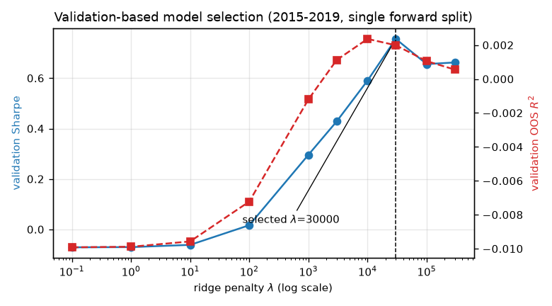
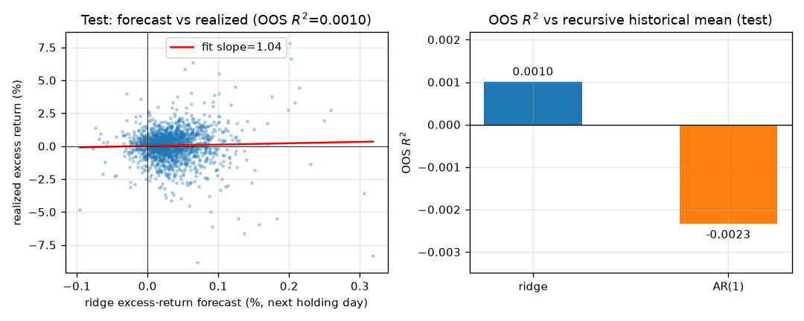
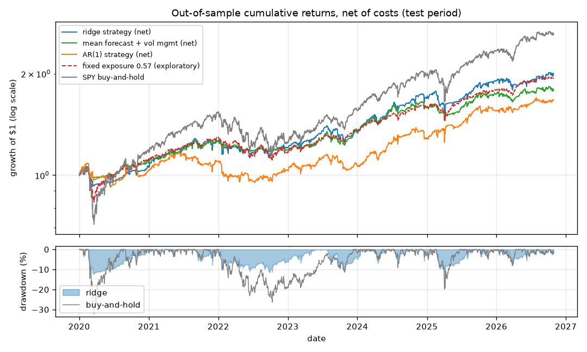
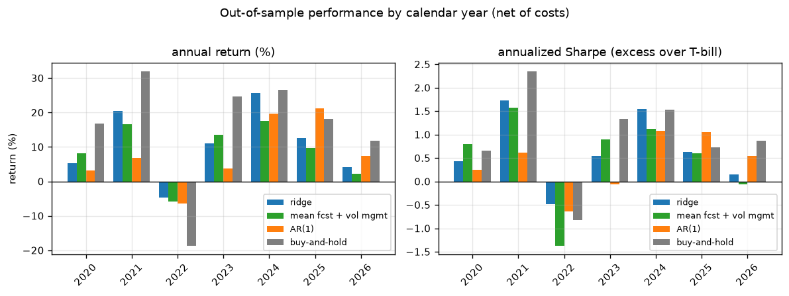

<div class="titleblock">

# Daily Market Timing on SPY with Ridge Shrinkage

### DSA5205 Project 2 — Design, Validate, and Analyze an Original Asset Trading Strategy

**Group_X** (Team name: *TBD*)

| Role | Name | Student ID |
|------|------|-----------|
| Member 1 | *TBD* | *TBD* |
| Member 2 | *TBD* | *TBD* |
| Member 3 | *TBD* | *TBD* |
| Member 4 | *TBD* | *TBD* |

National University of Singapore

November 2026

</div>

<div style="page-break-after: always;"></div>

## 1. Executive summary

This project designs, validates, and analyzes a daily market-timing strategy on the SPDR
S&P 500 ETF (SPY). After each market close we forecast the next holding day's **excess**
return from twelve technical features — short-horizon momentum/reversal, realized
volatility, moving-average deviations, RSI, intraday range, and volume change — using a
ridge regression whose shrinkage penalty is selected on a strictly later validation
window. The forecast is converted into a volatility-managed position,
$\pi_t$ = clip($\hat y_t/(\gamma\hat\sigma^2_t)$, −1.5, 1.5), executed at the **next
day's open** — never at the same close that produced the signal. Uninvested capital earns
the T-bill rate, leverage borrows at it, and trades pay 1 basis point per unit of
turnover.

The procedure is built around leakage control and honest evaluation. Features use only
information known at the decision close; standardization is fitted on the training window
and applied forward; the shrinkage penalty is chosen on 2015–2019 validation data from a
small pre-set grid of ten values; and the frozen configuration is then evaluated once on
2020–2026. Diagnostics computed after seeing the test results (cost/cap/long-only
variants, a fixed-exposure benchmark, CAPM attribution) are reported separately as
exploratory analysis and were not used to re-select anything.

Headline out-of-sample results (2020-01-02 to 2026-10-28, 1,715 trading days, net of
costs): the ridge strategy earns 10.5% annualized with 12.3% volatility, a Sharpe ratio
of 0.64, and a maximum drawdown of −14.1%, versus 15.1% / 19.1% / 0.69 / −32.1% for
buy-and-hold SPY. It clearly beats an AR(1) forecast through the identical position rule
(Sharpe 0.42, which loses 1.75% per year to costs). **Attribution, however, tempers the
story.** A constant mean forecast through the same volatility-managed rule already
achieves a Sharpe of 0.65, and a fixed 0.57× SPY exposure matches buy-and-hold's Sharpe
at much lower volatility: most of the strategy's character comes from volatility
management and lower average market exposure, not from the twelve features. A CAPM
regression gives an annualized alpha of 1.8% with a Newey–West $t$-statistic of only
0.59 — positive but statistically indistinguishable from zero. We therefore do not claim
a robust market-timing alpha; the defensible findings are that shrinkage stabilizes a
collinear weak-signal problem, that volatility-managed sizing reshapes the risk profile
exactly as advertised (volatility cut by a third, drawdown more than halved), and that
cost awareness changes model rankings.

The report follows the project brief: markets and timing (§2), labels and features (§3),
benchmarks (§4), model choice (§5), data split (§6), training (§7), validation (§8), the
trading rule and costs (§9), out-of-sample evaluation (§10), attribution (§11),
interpretation (§12), and reproducibility (§13).

## 2. Markets, assets, timing, and data sources (brief §4.1)

**Asset.** A single, highly liquid asset: the SPDR S&P 500 ETF (SPY, NYSE Arca). SPY's
depth makes a 1 bp cost assumption and the absence of market-impact modeling defensible
at our position sizes (notional capped at 1.5× equity), and a single-asset design keeps
the whole pipeline transparent.

**Frequency and trading times.** Daily. The decision is made **after the close of day
$t$**, using only information available up to and including that close. Because the
closing price and the day's full OHLCV are not knowable before the close, we do **not**
assume execution at that same close: the order is executed at the **open of day $t+1$**
(the first genuinely executable price), and the position is held from open $t+1$ to open
$t+2$. The label in §3 is built to match this holding period exactly.

**Calendar and currency.** US exchange calendar (NYSE trading days), USD throughout, no
FX considerations.

**Investable benchmark.** Buy-and-hold SPY, plus the forecast-based and risk-matched
benchmarks of §4.

**Data sources (lawful, public).**

| Series | Source | Details |
|---|---|---|
| SPY daily OHLCV | Yahoo Finance chart API (via `requests`; `yfinance` as fallback) | split- and dividend-adjusted (total-return) OHLC |
| 3-month T-bill rate | FRED series DTB3; Yahoo `^IRX` (13-week T-bill yield) as fallback | annualized percent, converted to a daily rate |

Yahoo's adjusted series is backward-adjusted: historical prices are multiplied by the
product of split and dividend factors so returns are continuous across corporate actions.
Our fetch script (`code/fetch_data.py`) pulls the adjusted close together with raw OHLC,
rescales the OHLC block by the same adjustment factor, and runs verification checks per
the Appendix B checklist of the brief: no duplicated dates, no non-positive prices, and
zero days with $|r_t|>25\%$ over 5,641 observations (2004-06-01 to 2026-10-30); in
addition, a **per-event check** on the two most recent cash dividends confirms that the
vendor's adjusted return on each ex-date matches the manual total return
$(P_{ex}+D)/P_{prev}-1$ to within $3\times10^{-5}$ (residual from cent-level rounding).
The data-safety logic downloads and validates both series before atomically replacing the
cache, so a failed download can never corrupt a valid one. The risk-free leg of the
cached run uses Yahoo `^IRX` because the FRED endpoint was unreachable from our network
at fetch time; the two quote the same instrument, and the script tries FRED first on
every run. All analysis uses historical data only; no live trading of any kind is
involved.

## 3. Labels and features (brief §4.2)

**Label.** The prediction target is the excess return over the actual holding period.
With execution at open $t+1$ and a one-day holding period,

> $y_t$ = $Open_{t+2}/Open_{t+1} - 1$,  label in excess form:  $y_t - r_{f,t}$,

where $r_{f,t}$ is the daily T-bill accrual known at close $t$. Features at close $t$
therefore always predict a return that starts strictly after the decision, and the
strategy's realized P&L in §9–§10 is computed over exactly these open-to-open intervals.
We model the *excess* return so that the label, the position rule (a mean-variance ratio
of expected excess return to variance), and the Sharpe accounting all use one consistent
quantity.

**Features.** Twelve features, all computable at the close of day $t$, in four groups.

| Feature | Definition | Lookback | Why it might help |
|---|---|---|---|
| `ret_1` | close-to-close $r_t$ | 1 d | daily reversal/momentum |
| `mom_5`, `mom_10`, `mom_21` | $P_t/P_{t-k}-1$ | 1–4 wk | short-horizon trend |
| `vol_5`, `vol_21` | rolling std of $r$ | 1 wk / 1 mo | volatility state; risk scaling |
| `ma_ratio_10/50/200` | $P_t/\mathrm{MA}_k-1$ | 2 wk–10 mo | distance from trend; overextension |
| `rsi_14` | 14-day RSI | 2 wk | classic overbought/oversold gauge |
| `range_hl` | $(H_t-L_t)/P_t$ | 1 d | intraday stress / realized range |
| `vol_chg` | $\log V_t$ − 21-day mean of $\log V$ | 1 mo | abnormal attention / volume |

*Momentum/reversal* features are motivated by the literature on short-horizon return
autocorrelation (liquidity-provision reversal at daily horizons). *Volatility* features
capture the persistence of the variance process, used both as predictor and as the
denominator of the position rule. *Trend-deviation* features proxy for how stretched
price is relative to its recent path; *range/volume* proxy for intraday stress and
attention.

**Known at decision time.** Every feature is a deterministic function of OHLCV at or
before close $t$; row $t$ (features) predicts the open $t+1$ → open $t+2$ return. No
quantity revealed after the decision close is used — including for execution, which is
deferred to the next open.

**Scaling.** Features are z-scored with mean and standard deviation **fitted on the
training window only**, then applied unchanged to validation and (after refitting on
train+validation) to test. The scaler never sees the period it is applied to.

**Cleaning.** SPY is clean and liquid; we (i) drop rows with missing OHLCV, (ii) verify
no duplicated dates and no non-positive prices, (iii) verify no single-day moves beyond
±25% (none occur), and (iv) drop the initial 200 trading days consumed by the longest
lookback (plus the two trailing days consumed by the label). No winsorization: extreme
days such as the COVID crash are genuine market data that the risk scaling should react
to, not outliers to erase. Missing risk-free quotes (holidays) are forward-filled.

## 4. Benchmarks (brief §4.3)

Five references, all over the identical test dates and — where applicable — the identical
position rule and cost model:

1. **Buy-and-hold SPY** — the investable alternative a real investor could hold.
2. **AR(1) forecast baseline** — OLS of the excess label on `ret_1` only, refit on the
   same training data, put through the *same* volatility-managed position rule with its
   own training-calibrated risk scaler. Isolates the value of the multivariate ridge
   signal over the simplest time-series forecast.
3. **Mean forecast + volatility management** — a *constant* forecast (the training mean
   excess return) through the identical position rule. This is the key attribution
   benchmark: any gap between the ridge strategy and this row is the incremental value
   of the twelve features; the row itself captures the value of volatility-managed
   sizing alone.
4. **Fixed-exposure benchmark (exploratory)** — a constant SPY weight equal to the ridge
   strategy's average test exposure (0.568), with the same cash accounting. Because it is
   calibrated on test information, it is reported as an exploratory diagnostic only: it
   checks whether the strategy's risk profile simply reflects holding less market.
5. **Recursive historical mean** — the expanding mean of the excess label using only
   labels fully realized by close $t$ (labels through $t-2$), the Campbell–Thompson style
   naive reference for $R^2_{OOS}$ = $1-\sum(y_t-\hat y_t)^2/\sum(y_t-\bar y_t)^2$.

## 5. Model choice and overfitting control (brief §4.4)

**Economic story.** At the daily horizon the market's conditional expected excess return
is driven by many weak forces at once: liquidity-driven reversal after large moves, short
trend continuation, the volatility state, and how stretched prices are relative to trend.
No single feature is reliable — daily predictability is famously faint — but a weighted
combination of weak, correlated signals may still carry information, *provided* the
estimation noise in the weights is controlled.

**Why ridge.** The twelve features are highly collinear (momentum, moving-average, and
RSI features all load on recent returns). OLS on collinear features has large coefficient
variance, which at daily signal-to-noise ratios turns into unstable forecasts and — after
position sizing — wasteful turnover. Ridge adds an $\ell_2$ penalty $\lambda\|\beta\|^2$
that pulls coefficients toward zero, trading a small bias for a large variance reduction.
This is the classic bias–variance trade-off: with many correlated weak predictors and a
low signal-to-noise ratio, shrinking the coefficients reduces estimation error and
stabilizes both the forecast and the resulting trades. The dense-weight assumption of
ridge (many small contributions) matches our story better than a sparse selector, which
suits settings where only a handful of predictors matter at a time (the one-minute
cross-sectional setting of Chinco, Clark-Joseph, and Ye, 2019).

**Scope note on the "virtue of complexity".** Kelly, Malamud, and Zhou (2024) show that
expected out-of-sample timing performance can *rise* with model complexity under proper
shrinkage — but their result is proved in a high-dimensional regime (thousands of
generated features, dense roughly isotropic signals, sufficient mixing). Our model has
twelve hand-picked, highly correlated features and ~2,500 training observations, which is
decidedly not that regime, and we do not claim our results validate their theory. What
our experiment does support is the narrower, standard point: under low signal-to-noise
and collinearity, ridge shrinkage reduces forecast and trading instability relative to
unpenalized estimation (see the validation curve in §8). We deliberately do not add
random features or a nonlinear model to chase the high-complexity regime: with ~2,500
training days the added flexibility would mostly fit noise, and the linear model keeps
the coefficient table (§12) directly interpretable.

**Overfitting control.** Four mechanisms, layered:

1. **Shrinkage**, with $\lambda$ selected out of sample on validation (§8), not in
   sample.
2. **A small, fixed feature set** — twelve interpretable features chosen once, before any
   fitting.
3. **A single chronological train/validation/test split, used in order** (§6).
4. **Position caps and volatility scaling** — even a wrong forecast cannot produce an
   unbounded bet: $|\pi_t|\le 1.5$, and positions shrink automatically when realized
   variance rises (§9).

## 6. Data period, split, and test discipline (brief §4.5)

The raw download covers 2004-06-01 to 2026-10-30; after the 200-day lookback features and
the two-day-ahead label, the usable sample is **2005-03-18 to 2026-10-28 (5,435
observations)**, split chronologically:

| Split | Period (actual decision dates) | Days | Used for |
|---|---|---|---|
| Training | 2005-03-18 – 2014-12-30 | 2,463 | fit scaler, ridge, AR(1); calibrate $\gamma$ |
| Validation | 2015-01-02 – 2019-12-30 | 1,257 | select $\lambda$ (the only hyperparameter) |
| Test | 2020-01-02 – 2026-10-28 | 1,715 | confirmatory out-of-sample evaluation |

**Leakage control.** Nothing fitted on later data is used on earlier data: (i) the
standardizer is fitted on the training window (train+validation for the final model) and
applied forward; (ii) the recursive naive forecast uses only labels fully realized by the
decision date (through $t-2$); (iii) $\gamma$ is calibrated on the fitting sample only;
(iv) the label starts at the next day's open, so no same-close execution assumption is
involved. In addition, **boundary rows**: because the label of decision day $t$ is only
realized at the open of $t+2$, every fit and model-selection sample is restricted to rows
whose stored `label_end_date` is on or before the first out-of-sample decision date —
this removes exactly one boundary row per split (2014-12-31 from training, 2019-12-31
from validation and from the final fitting sample), enforced by assertions in
`code/run_backtest.py::split_dataset` and by `code/test_backtest.py`.

**Test discipline — confirmatory vs exploratory analysis.** The **confirmatory** analysis
is a single evaluation of the frozen configuration (features, $\lambda$ from validation,
$\gamma$, position rule, 1 bp cost) on the test window. After seeing those results we ran
**exploratory** diagnostics — the fixed-exposure benchmark, CAPM attribution, and the
cost/cap/long-only variants of Appendix D — to understand *where* performance comes from.
These diagnostics use test information and are labelled exploratory wherever they appear;
none was used to re-select the model, and we do not describe the test window as
"untouched". Had we changed the strategy on the basis of these diagnostics, the same
period could no longer serve as an honest test set.

## 7. Training (brief §4.6)

**Method.** Ridge is fitted in closed form, $\hat\beta=(X^\top X+\lambda I)^{-1}X^\top y$,
via `sklearn.linear_model.Ridge` (unpenalized intercept, pre-standardized features), with
the excess label as the target. The AR(1) baseline is OLS via
`sklearn.linear_model.LinearRegression` on `ret_1`. Training is deterministic up to
floating-point order.

**Protocol.** For validation, scaler and ridge are fitted on 2005–2014 and scored on
2015–2019 for each $\lambda$ in the grid. For the final test, scaler and ridge are
**refitted on 2005–2019** with the selected $\lambda$, then frozen.

**Reproducibility.** Seed 42 is fixed (the pipeline is deterministic; the seed is set
defensively). Versions recorded in `output/results/run_config.json`: Python 3.14.6, numpy
2.5.3, pandas 3.0.6, scikit-learn 1.9.1. The grid, selected $\lambda$, fitted
coefficients, $\gamma$ values, caps, and cost are stored in the same file; every number
in this report regenerates via the commands in §13.

<div style="page-break-after: always;"></div>

## 8. Validation and model selection (brief §4.7)

**Method.** A single time-respecting forward split: fit on 2005–2014, evaluate on
2015–2019. Forward validation respects time order — unlike random-fold cross-validation
it never fits on the future to predict the past — and mimics live use (fit on the past,
apply to the next period).

**Search.** A small, pre-set grid of **ten** ridge penalties,
$\lambda\in\{0.1,1,10,100,10^3,3\times10^3,10^4,3\times10^4,10^5,3\times10^5\}$ — ten
models tried in total, nothing else tuned. **Selection rule (defined in advance):** the
$\lambda$ with the highest validation Sharpe of the net-of-cost strategy.



*Figure 4. Validation-based model selection. Left axis: validation strategy Sharpe (net
of costs). Right axis: validation OOS $R^2$ vs the recursive-mean naive forecast. Strong
shrinkage dominates; the Sharpe-optimal penalty is $\lambda=3\times10^4$.*

Lightly penalized models ($\lambda\le 100$) are *worse* than doing nothing on validation
(Sharpe ≈ 0 or negative, $R^2_{OOS}<0$): without shrinkage the collinear features produce
noisy forecasts, and the position rule converts noise into turnover and costs.
Performance rises monotonically with $\lambda$ up to $\lambda=3\times10^4$ (validation
Sharpe 0.76, annualized return 11.1% at 13.8% volatility) and flattens beyond. This is
the textbook bias–variance trade-off: with weak collinear predictors, heavy shrinkage is
the main defence against overfitting. The selected model is **$\lambda=3\times10^4$**, an
interior optimum of the grid.

## 9. From predictions to positions (brief §4.8)

**Score-to-weight rule.** The excess-return forecast is converted into a position by a
volatility-managed (mean-variance style) rule:

> $\pi_t$ = clip( $\hat y_{t}$ / ( $\gamma \cdot \hat\sigma^2_{21,t}$ ), −1.5, +1.5 ),

where $\hat y_t$ is the ridge forecast of the holding-day excess return and
$\hat\sigma^2_{21,t}$ is the 21-day realized variance known at close $t$. This is the
mean-variance/Kelly logic (Moreira–Muir style volatility management): position
proportional to expected excess return, inversely proportional to variance. The
risk-aversion analogue $\gamma$ is calibrated on the **training data only** so that the
average absolute *pre-clip* position $|\hat y/(\gamma\hat\sigma^2)|$ equals 1 there; the
±1.5 cap is applied afterwards, so the realized mean $|\pi|$ can be below 1
($\gamma_{\text{ridge}}=7.92$, $\gamma_{\text{AR(1)}}=10.66$,
$\gamma_{\text{mean}}=8.78$). $\gamma$ is then held fixed out of sample. The $\pm1.5$ cap
bounds leverage at 1.5× and permits shorts — a simple, stated risk limit.

**Cash, financing, and short accounting.** The position $\pi_t$ is the fraction of
equity in SPY; the remaining $1-\pi_t$ earns the T-bill rate. Leverage above 1× borrows
at the T-bill rate; short positions invest the proceeds at the T-bill rate. The portfolio
return over the holding day is therefore

> $r_{p,t}$ = $r_{f,t}$ + $\pi_t\,(y_t - r_{f,t})$ − $10^{-4}\,|\pi_t - \pi_{t-1}|$.

For SPY — one of the easiest-to-borrow securities in the world — the stock-borrow fee is
a few basis points per year and is neglected; this is stated as an assumption rather than
modelled.

**Execution.** Orders are executed at the **open of day $t+1$** (the first price after
the signal is computable); positions are held to the open of $t+2$ and rebalanced at each
open. The label, the backtest P&L, and this execution rule are aligned by construction.

**Costs.** Daily strategies cannot assume costs away: we charge **1 bp ($10^{-4}$) per
unit of target-weight turnover** $|\pi_t-\pi_{t-1}|$. This is a deliberately simple
*proxy*, not an exact fill model: it ignores the weight drift that market moves induce
between rebalances, intraday slippage against the open print, market impact, and the
terminal liquidation of the final position. For SPY at our sizes these are second-order,
and Appendix D shows the test Sharpe degrades gracefully (0.67 / 0.64 / 0.60 at
0.5 / 1 / 2 bp). For transparent comparison, the buy-and-hold benchmark is charged no
costs at all — a single entry trade — which is generous to the benchmark, not to the
strategy. Turnover and the resulting drag are reported explicitly in §10.

**Risk discipline.** The $\pm1.5$ cap; automatic de-risking via the $\hat\sigma^2_{21}$
denominator in volatile regimes; and turnover implicitly penalized through the cost term,
which makes faint forecasts uneconomic to trade.

<div style="page-break-after: always;"></div>

## 10. Out-of-sample evaluation (brief §4.9)

**Train–test correspondence.** Everything the confirmatory test evaluation uses was
frozen before the test window: the feature definitions, the scaler (fitted on
2005–2019), the ridge coefficients ($\lambda=3\times10^4$ chosen on 2015–2019), $\gamma$,
the position rule and cap, and the 1 bp cost. At each test date we compute features after
close $t$, forecast the excess return, set $\pi_t$, execute at open $t+1$, earn
$r_f + \pi_t(y_t-r_f)$ minus turnover costs over the holding day, and move forward. The
test window 2020-01-02 to 2026-10-28 (1,715 days: COVID crash, 2022 bear market,
2023–2026 bull run) received exactly one confirmatory evaluation.

**Headline metrics (net of costs; Sharpe on excess over T-bill).**

| Model | Split | Days | Ann. return | Ann. vol | Sharpe | Max DD | Avg daily turnover | Ann. cost drag | OOS $R^2$ |
|---|---|---|---|---|---|---|---|---|---|
| Ridge strategy | validation | 1,257 | 11.1% | 13.8% | 0.76 | −16.5% | 0.16 | 0.40% | 0.0020 |
| **Ridge strategy** | **test** | **1,715** | **10.5%** | **12.3%** | **0.64** | **−14.1%** | **0.21** | **0.53%** | **0.0010** |
| Mean fcst + vol mgmt | test | 1,715 | 8.8% | 9.3% | 0.65 | −9.7% | 0.04 | 0.10% | 0.0001 |
| AR(1) strategy | test | 1,715 | 7.8% | 13.1% | 0.42 | −18.5% | 0.69 | 1.75% | −0.0023 |
| Fixed exposure 0.568* | test | 1,715 | 10.2% | 10.8% | 0.69 | −19.3% | 0.00 | 0.00% | — |
| Buy-and-hold SPY | test | 1,715 | 15.1% | 19.1% | 0.69 | −32.1% | — | — | — |

*Fixed exposure is an exploratory diagnostic calibrated on the ridge strategy's average
test position (§11); it is not a tradable pre-specified strategy.*

Three observations:

1. **Ridge beats AR(1) clearly as a trading strategy** (Sharpe 0.64 vs 0.42). The AR(1)
   forecast flips sign constantly, trades 0.70 units/day, and pays 1.75% per year in
   costs; its forecast $R^2_{OOS}$ is negative against the recursive mean. The shrunken
   multivariate forecast is smoother (turnover 0.21, drag 0.54%).
2. **Buy-and-hold still edges the strategy on Sharpe** (0.69 vs 0.64) in a mostly bullish
   window, but the strategy cuts volatility from 19.1% to 12.3% and the worst drawdown
   from −32.1% to −14.1%.
3. **Validation→test degradation is modest** (Sharpe 0.76 → 0.64), the expected haircut
   from validation-based selection; the sign of the edge survives.

**Required plots.**



*Figure 1. Out-of-sample prediction quality. Left: ridge excess-return forecast vs
realized excess return on the test window, with fitted slope. Right: OOS $R^2$ against
the recursive historical-mean naive forecast for ridge and AR(1).*



*Figure 2. Cumulative out-of-sample performance, net of costs, log scale, with drawdowns
below. Buy-and-hold ends highest but lives through −32% (COVID 2020) and −25% (2022)
troughs; the ridge strategy compounds more smoothly; the mean-forecast and
fixed-exposure benchmarks track it closely — the subject of §11.*



*Figure 3. Performance by calendar year (Sharpe computed on excess over T-bill,
consistent with the headline table). The strategy's relative value concentrates in stress
years — 2022: −4.6% vs −18.7% for buy-and-hold — while it gives up upside in melt-up
years.*

**Per-year detail (net of costs).**

| Year | Ridge ret | Ridge Sharpe | Mean-fcst ret | Mean-fcst Sharpe | AR(1) ret | AR(1) Sharpe | B&H ret | B&H Sharpe |
|---|---|---|---|---|---|---|---|
| 2020 | 5.3% | 0.43 | 8.1% | 0.80 | 3.1% | 0.25 | 16.8% | 0.66 |
| 2021 | 20.3% | 1.74 | 16.6% | 1.57 | 6.9% | 0.62 | 31.9% | 2.35 |
| 2022 | −4.6% | −0.49 | −5.8% | −1.38 | −6.3% | −0.63 | −18.7% | −0.83 |
| 2023 | 11.0% | 0.55 | 13.5% | 0.90 | 3.7% | −0.07 | 24.6% | 1.34 |
| 2024 | 25.7% | 1.54 | 17.5% | 1.12 | 19.6% | 1.08 | 26.5% | 1.54 |
| 2025 | 12.6% | 0.62 | 9.7% | 0.60 | 21.1% | 1.05 | 18.2% | 0.73 |
| 2026 (to Oct) | 4.1% | 0.16 | 2.3% | −0.06 | 7.5% | 0.55 | 11.8% | 0.87 |

## 11. Attribution: where does the performance come from?

A strategy can beat its benchmark by holding *less* market, by *managing* exposure over
time, or by *forecasting* returns. These have very different economic meanings, so we
decompose the ridge strategy's test performance against the benchmarks of §4.

**Exposure.** The ridge strategy holds SPY 88.5% of days with an average position of
0.568 — it is, on average, roughly half invested. A fixed 0.568× SPY weight with the same
cash accounting earns a Sharpe of 0.69 — matching buy-and-hold (0.69) at barely over half
the volatility. So at this horizon, simply *holding less market* already reproduces the
headline Sharpe; the low drawdown of the timing strategy is largely a low-exposure
effect.

**Volatility management.** The mean-forecast row isolates the position rule: a constant
bullish forecast, scaled each day by $1/\hat\sigma^2_{21}$, achieves Sharpe 0.65 with the
lowest drawdown of any row (−9.7%) and almost no turnover (0.04/day, 0.10%/yr drag).
Volatility-managed sizing by itself explains most of the strategy's character — cutting
exposure in high-variance regimes (2020, 2022) and restoring it in calm ones.

**Forecasting increment.** What the twelve features add on top is modest: ridge return is
higher than the mean-forecast row (10.5% vs 8.8%) but with higher volatility, for an
essentially identical Sharpe (0.64 vs 0.65); and the forecast $R^2_{OOS}$ is 0.0010 —
positive against the recursive mean, but economically tiny.

**CAPM.** Regressing the strategy's daily net excess return on the market excess return
(Newey–West $t$-statistics, lag 5):

| Model | $\alpha$ (ann.) | $\beta$ | $t(\alpha)$ | $t(\beta)$ |
|---|---|---|---|---|
| Ridge strategy | +1.8% | 0.47 | 0.59 | 11.59 |
| Mean fcst + vol mgmt | +1.6% | 0.34 | 0.66 | 9.71 |
| AR(1) strategy | +0.9% | 0.35 | 0.23 | 8.17 |

The market beta of 0.47 confirms the low-exposure character. The alpha is positive but
its $t$-statistic of 0.59 is far from significant — the data do not reject "no alpha".
Notably, the mean-forecast benchmark shows a similar insignificant alpha, consistent with
volatility management (a real, documented effect — Moreira and Muir, 2017) rather than
return prediction driving both.

**What we conclude.** The strategy's out-of-sample behavior is explained primarily by
(i) lower average market exposure and (ii) volatility-managed sizing; the incremental
contribution of the twelve technical features is small and not statistically
established. We do not claim a robust timing alpha.

## 12. Interpretation: what worked, what did not

**What the model learned.** Fitted coefficients (standardized features, 2005–2019) are
dominated by *short-horizon reversal*: `ret_1` (−7.2×10⁻⁵), `mom_5` (−9.4×10⁻⁵),
`mom_10` (−5.0×10⁻⁵), `ma_ratio_10` (−8.7×10⁻⁵) all carry negative weights — after
up-moves and above-trend prices the model expects give-back. Volatility features carry
small negative weights; `range_hl` (+3.6×10⁻⁵) is small positive; the intercept
(+3.6×10⁻⁴ ≈ 9.6%/yr) is the unconditional excess premium. Every coefficient is small —
shrinkage spreads the signal thinly across all twelve features.

**What worked.** (i) *Shrinkage*: the single most important design choice — validation
Sharpe went from ≈ 0 at $\lambda\le100$ to 0.76 at $\lambda=3\times10^4$, and the edge
survived into the test window. (ii) *Volatility-managed sizing*: it, not the forecast,
produced the attractive risk profile, as the mean-forecast benchmark makes visible
(Sharpe 0.65, max DD −9.7% standalone). (iii) *Cost-aware evaluation*: it changed
rankings — AR(1) looks acceptable gross and is clearly inferior net. (iv) *Executable
timing*: moving execution to the next open removed the same-close look-ahead that a close
t signal cannot honestly trade on. (v) *Process discipline*: one confirmatory test
evaluation, with all later diagnostics clearly fenced off as exploratory.

**What did not work.** (i) *Beating buy-and-hold in a bull market*: the strategy
underperforms on raw return and slightly on Sharpe over 2020–2026; partial exposure
forgoes upside in persistent uptrends. (ii) *Demonstrating forecast value*: the ridge
forecast's $R^2_{OOS}$ of 0.0010 is statistically and economically faint, the CAPM alpha
is insignificant, and the features add no Sharpe over volatility-managed sizing alone —
an honest negative result about daily technical predictability, not a model failure.
(iii) *AR(1) as a benchmark*: its negative test $R^2_{OOS}$ confirms that the simplest
autoregressive signal does not survive contact with costs.

**Limitations.** Single asset (no cross-sectional diversification of signal noise); a
single train/validation/test split; flat 1 bp cost with no market-impact or
borrow-fee modeling; linear model only; no statistical significance claimed for the
forecast itself. Natural extensions, in order: expanding-window periodic refits, and a
small cross-section of index ETFs to diversify signal noise. We deliberately did not add
model complexity (random features, neural networks): the binding constraint is the faint
daily signal, not functional flexibility, and a larger search would raise the risk of
test-set reuse.

## 13. Reproducibility

All results regenerate end-to-end from the package root (see `README.md`;
`requirements.txt` pins versions):

```
python code/fetch_data.py      # downloads SPY + T-bill data into data/ (skippable: cache is committed)
python code/run_backtest.py    # writes output/results/*.csv + run_config.json
python code/run_robustness.py  # Appendix D diagnostics -> output/results/robustness.csv
python code/make_figures.py    # writes output/figures/*.png + yearly_stats.csv
python code/build_report.py    # rebuilds this PDF from report.md (needs pandoc)
python code/test_backtest.py   # boundary / drawdown / naive-forecast assertions
```

The committed `data/` cache lets the whole pipeline run without network access;
`fetch_data.py` is only needed to refresh the data, and it validates both series
before atomically replacing the cache, so a failed download never corrupts it.

Fixed seed (42), relative paths only, no hard-coded local directories, no API keys. The
environment, grid, selected $\lambda$, coefficients, $\gamma$ values, and test
diagnostics (average position, long-day share) are in `output/results/run_config.json`.
Figure-to-code cross-reference: Figures 1–4 ← `make_figures.py` ← `output/results/*.csv`
← `run_backtest.py` ← `data/*.csv` ← `fetch_data.py`. The video walkthrough runs these
commands in order and shows the same artifacts.

**Safety note.** Research/backtesting on historical public data only; no real orders
were or will be placed.

## 14. Contribution note

| Member | Contribution |
|---|---|
| Member 1 | *TBD* |
| Member 2 | *TBD* |
| Member 3 | *TBD* |
| Member 4 | *TBD* |

All members reviewed the final report, code, and video.

<div style="page-break-after: always;"></div>

## Appendix A. Fitted model

Final ridge model, refitted on 2005–2019 with $\lambda=3\times10^4$ on standardized
features (coefficients comparable in magnitude). Negative momentum/trend coefficients =
short-horizon reversal. Source: `output/results/run_config.json`.

| Feature | Coefficient | Sign reading |
|---|---|---|
| `ret_1` | −7.2×10⁻⁵ | 1-day reversal |
| `mom_5` | −9.4×10⁻⁵ | weekly reversal |
| `mom_10` | −5.0×10⁻⁵ | 2-week reversal |
| `mom_21` | −3.5×10⁻⁵ | monthly reversal |
| `vol_5` | −2.9×10⁻⁵ | high vol → lower expected return |
| `vol_21` | −1.9×10⁻⁵ | high vol → lower expected return |
| `ma_ratio_10` | −8.7×10⁻⁵ | above-trend → give-back |
| `ma_ratio_50` | −3.4×10⁻⁵ | above-trend → give-back |
| `ma_ratio_200` | −1.1×10⁻⁵ | above-trend → give-back |
| `rsi_14` | −2.2×10⁻⁵ | overbought → give-back |
| `range_hl` | +3.6×10⁻⁵ | wide range → small positive |
| `vol_chg` | −0.2×10⁻⁵ | volume spike → negligible |
| intercept | +3.65×10⁻⁴ | unconditional premium ≈ 9.6%/yr |

AR(1) baseline: a small negative slope on `ret_1` (daily reversal).

## Appendix B. Full validation grid

All ten models tried (the complete search — nothing else was tuned), fitted on 2005–2014
and scored on 2015–2019. Source: `output/results/lambda_selection.csv`.

| $\lambda$ | Val. Sharpe | Val. ann. return | Val. OOS $R^2$ |
|---|---|---|---|
| 0.1 | −0.07 | −0.9% | −0.0099 |
| 1 | −0.07 | −0.8% | −0.0099 |
| 10 | −0.06 | −0.7% | −0.0096 |
| 100 | +0.02 | 0.3% | −0.0072 |
| 1,000 | 0.30 | 4.3% | −0.0012 |
| 3,000 | 0.43 | 6.3% | +0.0011 |
| 10,000 | 0.59 | 8.8% | +0.0024 |
| **30,000** | **0.76** | **11.1%** | **+0.0020** |
| 100,000 | 0.66 | 8.8% | +0.0011 |
| 300,000 | 0.66 | 8.5% | +0.0006 |

## Appendix C. Data dictionary

Raw files in `data/` (produced by `code/fetch_data.py`):

| File | Columns | Notes |
|---|---|---|
| `spy_daily.csv` | `date, open, high, low, close, volume` | split/dividend-adjusted OHLCV, 2004-06-01 → 2026-10-30, 5,641 rows |
| `dtb3.csv` | `date, dtb3` | annualized 3-month T-bill rate in percent (FRED DTB3, or Yahoo ^IRX fallback) |

Derived panel (built in memory by `code/features.py::build_dataset`): one row per
decision date $t$ from 2005-03-18 to 2026-10-28 (5,435 rows), with the twelve features of
§3, the 21-day realized variance $\hat\sigma^2_{21,t}$, the open-to-open label
`fwd_ret` ($Open_{t+2}/Open_{t+1}-1$), `label_end_date` (the date the label is fully
realized — the open of $t+2$ — used to exclude unrealized labels at split boundaries),
the risk-free accrual `rf_next`, the excess label `fwd_excess`, and the recursive naive
forecast `naive_excess` (expanding mean of `fwd_excess` through $t-2$). No derived data
is persisted; everything is rebuilt from the raw files on every run.

## Appendix D. Robustness diagnostics (exploratory)

The following variants were computed **after** the single confirmatory test evaluation,
as diagnostics of how sensitive the conclusions are to design knobs. They use test
information, were not used to re-select anything, and the submitted configuration remains
the pre-set one ($\lambda$ from the validation grid, cap ±1.5, 1 bp cost, long/short).
Every number below is generated by `code/run_robustness.py` from the frozen main
configuration and stored in `output/results/robustness.csv`.

1. **Cost sensitivity.** Test Sharpe is 0.67 at 0.5 bp, 0.64 at the 1 bp baseline, and
   0.60 at 2 bp per unit turnover: the ridge strategy degrades gracefully because its
   turnover is low. The AR(1) baseline (3× higher turnover) degrades much faster, so the
   ranking ridge > AR(1) is unchanged at every cost level.
2. **Position cap.** Capping at ±1.0 instead of ±1.5 leaves the test Sharpe essentially
   unchanged (0.66 vs 0.64; annualized return 9.7% vs 10.5%): the strategy does not
   depend on the leverage allowance.
3. **Long-only variant.** Clipping positions to $[0, 1.5]$ gives a test Sharpe of 0.64
   (vs 0.64 with shorts): most of the value comes from scaling exposure down in
   high-variance regimes, not from being short.

## References

- Campbell, J. Y., and S. B. Thompson (2008). Predicting excess stock returns out of
  sample: Can anything beat the historical average? *Review of Financial Studies* 21(4).
- Chinco, A. M., A. D. Clark-Joseph, and M. Ye (2019). Sparse signals in the
  cross-section of returns. *Journal of Finance* 74(1), 449–492.
- Kelly, B. T., S. Malamud, and K. Zhou (2024). The virtue of complexity in return
  prediction. *Journal of Finance* 79(1), 459–501.
- Moreira, A., and T. Muir (2017). Volatility-managed portfolios. *Journal of Finance*
  72(4), 1611–1644.
- Data: Yahoo Finance (SPY adjusted OHLCV, ^IRX); FRED (DTB3), Federal Reserve Bank of
  St. Louis.
